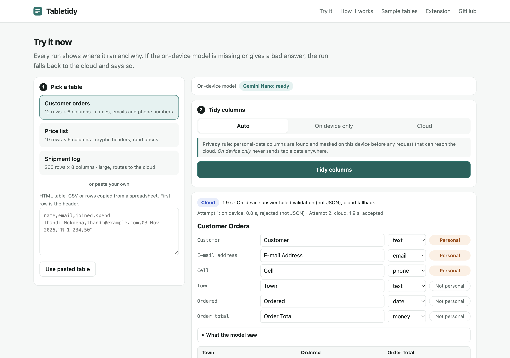
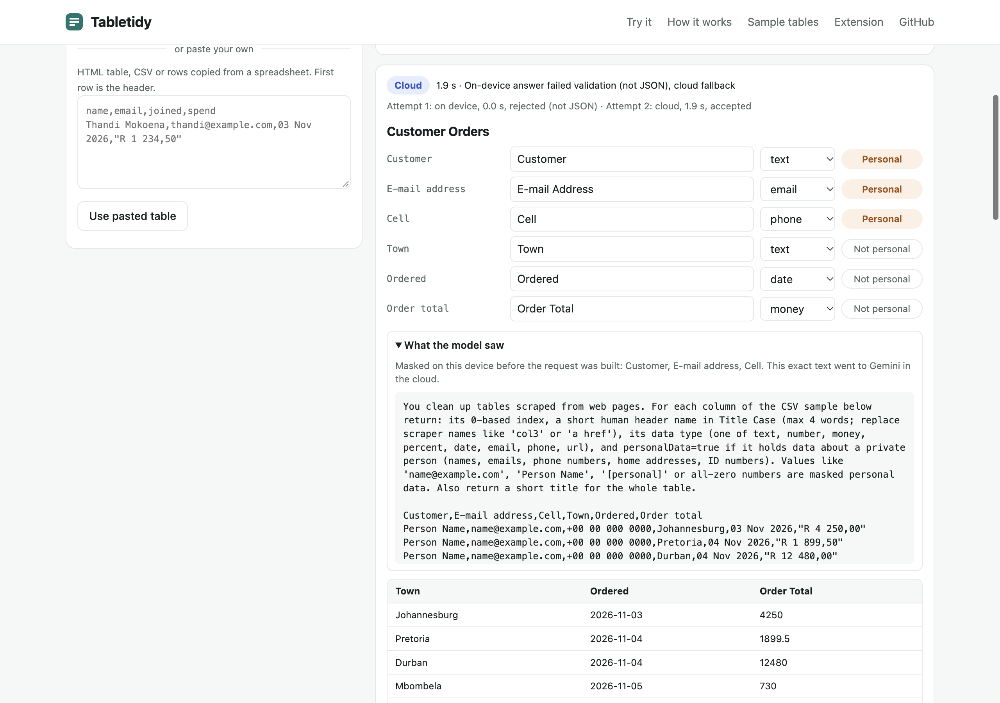
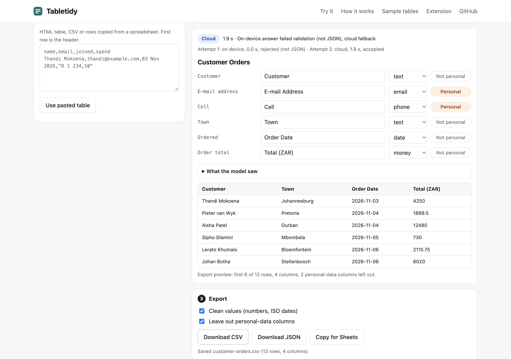
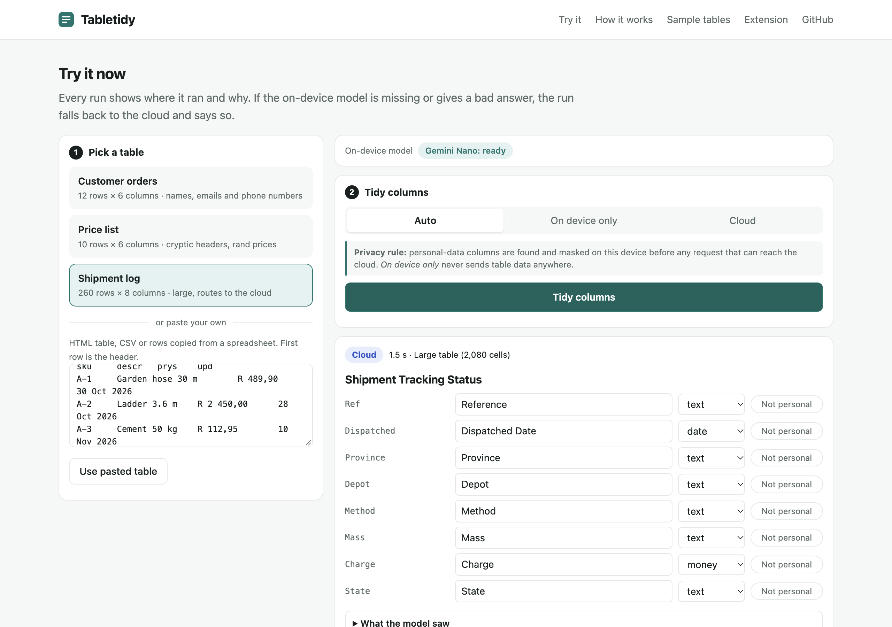

# Tabletidy

**Turn a messy table into a clean spreadsheet, without leaking the personal data in it.**

**Try it now, no install: https://tabletidy-82369.web.app**

Tabletidy is a web app and a Chrome extension built for #BuildHybridAI 2026. Give it a table (pick a sample, paste HTML, CSV or rows copied from a spreadsheet, or scan any web page with the extension). It proposes clean column names, a type for every column (date, money, number, percent, email, phone, URL, text) and flags columns that hold personal data. Edit anything, then export CSV or JSON with real numbers and ISO dates instead of `"R 1 234,50"` and `03 Nov 2026`.

## Try it (hosted, about one minute)

1. Open https://tabletidy-82369.web.app in desktop Google Chrome (139 or newer for the on-device model; any modern browser works for cloud runs).
2. Under **Try it now** click **Customer orders**, then **Tidy columns**.
3. Read the badge: **On device** or **Cloud**, the time, and the reason for the route. Open **What the model saw** to see the exact text that was sent, with names, emails and phone numbers masked.
4. Rename a column, change a type, toggle **Personal**, then **Download CSV** or **Download JSON**.
5. Try **Shipment log** (2,080 cells): Auto mode sends it to the cloud and says why. Or paste your own table.

The status line above the Tidy button shows the on-device model honestly: *not available in this browser*, *not downloaded yet* (with a **Download model** button, about 3 GB, one time), *downloading* with progress, or *ready*. No sign-in, no API key, nothing to configure: cloud calls from the hosted site are protected by Firebase App Check with reCAPTCHA Enterprise.

| Masked payload | Edit and export |
|---|---|
|  |  |

More screenshots are in [`docs/screens`](docs/screens) (empty state, cloud run, pasted table, phone width).

## Value proposition

People who copy tables out of web pages and exports (sales ops, researchers, analysts, admins) spend their time renaming `col3` and `itm_cd` columns, fixing numbers with spaces and decimal commas, and deleting customer names and emails before they share a file. The third chore is the one that stops people pasting a table into a cloud AI tool at all. Tabletidy does all three in one click, and it does the sensitive part on the device:

- **Small tables prefer Gemini Nano in Chrome**: the table never leaves the browser and the run costs nothing.
- **Large tables go to Gemini in the cloud** through Firebase AI Logic, because Nano has a small context window. Columns flagged as personal data are **masked on the device before the request is built**.
- **Every run shows where it ran and why**: an `On device` or `Cloud` badge with the time and the reason ("Small table (72 cells)", "Large table (2,080 cells)", "Gemini Nano is not ready in this browser (downloadable), cloud fallback", "On-device answer failed validation (not JSON), cloud fallback").
- **"What the model saw"** shows the exact prompt, masks included.
- **Answers are never trusted blindly**: every model answer is validated against the schema and the table before it is used.

## How Firebase AI Logic hybrid inference is used

All runtime calls are in [`extension/src/ai.js`](extension/src/ai.js), one module shared by the hosted app and the extension:

| What | Where |
|---|---|
| App Check, reCAPTCHA Enterprise on the hosted site | `initializeAppCheck(app, { provider: new ReCaptchaEnterpriseProvider(...) })` [ai.js line 57](extension/src/ai.js#L57) |
| App Check, debug token in the extension | [ai.js lines 59-64](extension/src/ai.js#L59) |
| AI Logic backend (Gemini Developer API) | `getAI(app, { backend: new GoogleAIBackend() })` [ai.js line 66](extension/src/ai.js#L66) |
| Hybrid model per routing decision | `getGenerativeModel(ai, { mode: InferenceMode[...], onDeviceParams, inCloudParams })` [ai.js lines 74-86](extension/src/ai.js#L74) |
| Same schema on both runtimes | `responseConstraint` on device [line 79](extension/src/ai.js#L79), `responseSchema` in the cloud [line 84](extension/src/ai.js#L84) |
| Gemini Nano download on a user click | `model.initializeDeviceModel(onProgress)` [line 105](extension/src/ai.js#L105) |
| The call | `model.generateContent(prompt)` [line 116](extension/src/ai.js#L116) |
| On device / Cloud badge | `result.response.inferenceSource` [line 121](extension/src/ai.js#L121) |

Routing, privacy and fallback are plain, unit-tested functions:

- `route()` ([tidy.js line 15](extension/src/lib/tidy.js#L15)): **Auto** uses `PREFER_ON_DEVICE` for tables up to 1,500 cells and `PREFER_IN_CLOUD` above that. **On device only** uses `ONLY_ON_DEVICE` (raw values allowed because nothing leaves the browser). **Cloud** uses `ONLY_IN_CLOUD`. Every mode that can reach the cloud has `mask: true`.
- `buildPrompt()` ([tidy.js line 46](extension/src/lib/tidy.js#L46)) masks the flagged columns *before* the prompt text exists. Masks keep the shape (`+00 00 000 0000`, `name@example.com`, `Person Name`) so the model can still type the column.
- `validateAnswer()` ([hybrid.js line 14](extension/src/lib/hybrid.js#L14)) checks every answer: non-empty, JSON, a title, and exactly one valid entry (index, name, known type, boolean flag) per column of the table.
- `runHybrid()` ([hybrid.js line 53](extension/src/lib/hybrid.js#L53)): if a `PREFER_ON_DEVICE` answer is empty, not JSON or fails validation, the same already-masked prompt is sent once with `ONLY_IN_CLOUD` and the badge gives the reason. `ONLY_ON_DEVICE` never falls back to the cloud; it keeps the device rules result and says so.
- `mergeColumns()` ([tidy.js line 109](extension/src/lib/tidy.js#L109)): the model can rename, retype (only if the values actually parse as that type) and *add* personal-data flags. It can never remove a flag set by the on-device rules.

The flow for one run: table in (sample, paste or page scan) -> on-device rules type every column and flag personal data ([`lib/infer.js`](extension/src/lib/infer.js), [`lib/pii.js`](extension/src/lib/pii.js)) -> route -> mask -> Firebase AI Logic hybrid call -> validate, cloud fallback if needed -> merge -> edit -> export. The view for all of that is [`extension/src/app.js`](extension/src/app.js), mounted by both surfaces.

## What has been tested, and what has not

Tested on the hosted URL in a Chromium 154 browser whose built-in model returns unusable text (a good test of the fallback):

- Cloud runs through Firebase AI Logic with App Check (reCAPTCHA Enterprise) on both `tabletidy-82369.web.app` and `tabletidy-82369.firebaseapp.com`. A request without an App Check token is rejected with 401.
- A prefer-on-device run whose on-device answer was not JSON fell back to the cloud and showed "On-device answer failed validation (not JSON), cloud fallback".
- Masking in "What the model saw", editing, CSV and JSON export, pasted tables, phone width, zero console errors.
- `npm test`: 48 unit tests (validator, fallback rules, parsing, routing, masking, type inference, the reused detection engine, and the hosted page's samples).

Not yet verified by us: a correct Gemini Nano answer in Google Chrome itself (so this README makes no claim about on-device speed), and the extension running as an installed unpacked extension. The automated build environment cannot start Google Chrome. The code path is the same one the tests and the hosted fallback exercise.

## Extension setup

The extension is the second surface: the same app in a Chrome side panel, fed by a page scanner that finds tables and repeated lists in any page. Requirements: Node 20+, desktop Google Chrome 139 or newer.

1. **Firebase project** (free Spark plan): create a project, add a Web app, open *AI Logic* and choose the Gemini Developer API. In *App Check*, register the web app and add a debug token.
2. **Config**: `cp .env.example web/.env.local` and fill in the web app config. `VITE_APPCHECK_DEBUG_TOKEN` is optional; you can paste the debug token into the extension's Settings instead (extensions cannot run reCAPTCHA).
3. **Build**: `npm install`, then `npm run build:ext` (outputs `extension/dist`). If your environment cannot run the bundler, run `npm run dev` once and then `npm run build:ext:nobundler` (vendors the pre-bundled Firebase ESM files). Run `npm test` for the unit tests.
4. **Load**: `chrome://extensions` -> Developer mode -> *Load unpacked* -> `extension/dist`. Pin Tabletidy, open a page with a table (the hosted page works), click the toolbar button and press *Scan this page*.

The extension ID is fixed by the `key` in [`extension/public/manifest.json`](extension/public/manifest.json) (`cedaeknpomelhkeakeeifcmmmcjdookp`), so the Firebase browser API key can be restricted to that origin. Our key is also restricted to the Firebase AI Logic, App Check and Installations APIs.

## Hosting your own copy of the web app

`npm run build:site` writes `site/` (the Firebase Hosting public directory, see `firebase.json`): [`tools/build-demo.mjs`](tools/build-demo.mjs) generates `site/index.html`, and [`tools/build-site.mjs`](tools/build-site.mjs) copies the shared modules from `extension/src` into `site/app`, vendors the Firebase ESM files and writes `site/app/config.js` from `web/.env.local` (Firebase web config and `VITE_RECAPTCHA_ENTERPRISE_SITE_KEY`). The build fails if an App Check debug token would end up in the public site. Register your hosting domains on the reCAPTCHA Enterprise key, then `firebase deploy --only hosting`. `site/app` is generated and not committed.

[`extension/tests/demo.test.mjs`](extension/tests/demo.test.mjs) runs the detection engine, the personal-data rules and the routing rule against the hosted page, so the samples cannot drift from the code. A small smoke test of the bare hybrid call lives in [`web/`](web/) (`npm run dev`, http://localhost:5173).

## Built during the contest vs reused

Tabletidy reuses the scraping engine of SKILLMERC's existing **List & Table Scraper** browser extension (public on Firefox Add-ons, about 12 daily users). It brings the part that is not AI: finding repeated rows and tables in any DOM, extracting cells and links, and writing CSV/JSON. Reused files, unchanged and marked at the top: `extension/src/lib/detect.js`, `export.js`, `zip.js`, the icons and `tests/detect.test.mjs`.

Built during the submission period (from 11 Nov 2026):

- Firebase project, AI Logic (Gemini Developer API), App Check (reCAPTCHA Enterprise and debug provider), API key restrictions, Hosting.
- `ai.js`: Firebase AI Logic hybrid inference with structured output on both runtimes, model status and download.
- `lib/hybrid.js`: answer validation and the on-device to cloud fallback rules.
- `lib/tidy.js`: routing, privacy masking, prompt, merge rules, export shaping.
- `lib/pii.js`: on-device personal-data rules and shape-preserving masks.
- `lib/infer.js`: deterministic type inference and value normalising (decimal commas, currency, ISO dates).
- `lib/parse.js`: pasted HTML table, CSV and TSV parsing.
- `app.js` and `ui.css`: the shared view and look; the hosted playground (`web/src/playground.js`, `site/`, `tools/`); the side panel, content script wrapper and service worker.
- Unit tests `tests/hybrid`, `tests/parse`, `tests/infer`, `tests/pii`, `tests/tidy`, `tests/demo`.

## AI coding agent disclosure

Most of the code in this repository was written by an AI coding agent (Aside, an agentic browser assistant running Anthropic's Claude) working for SKILLMERC, directed and reviewed by Kyle Pretorius. The agent also set up the Firebase project and the API key restrictions through the consoles. No other pre-existing code is included beyond the List & Table Scraper engine listed above and the open-source npm dependencies in `package.json`.

## Privacy

- The hosted app reads only what you paste or the sample you pick. The extension reads a page only after you click its toolbar button (`activeTab`).
- On device only mode never sends table data anywhere.
- In Auto and Cloud mode, columns flagged as personal data are replaced by placeholders before the prompt is built. You can flag or unflag any column, and exports leave flagged columns out by default.
- Nothing is stored except, in the extension, the App Check debug token you paste into Settings.

## License

Apache License 2.0. See [LICENSE](LICENSE).
